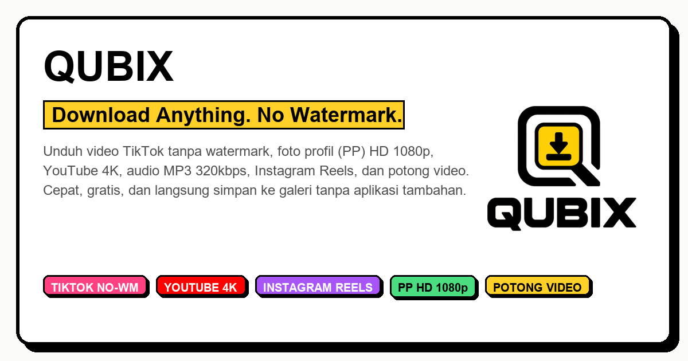

# 📦 QUBIX — Universal Multi-Platform Media Downloader

<div align="center">



<p align="center">
  <strong>Solusi modern pengunduh media sosial multi-platform berkinerja tinggi dengan antarmuka Neo-Brutalism dan arsitektur scraping mandiri murni (Pure 0-API).</strong>
</p>

[](https://nextjs.org/)
[](https://react.dev/)
[](https://www.typescriptlang.org/)
[](https://tailwindcss.com/)
[](LICENSE)
[](https://github.com/adambyte-dev)

</div>

---

## 🌟 Ikhtisar Proyek

**QUBIX** dirancang dari awal untuk memecahkan masalah umum website downloader: **ketergantungan pada API pihak ketiga berbayar / tidak stabil, kebocoran memori RAM server, dan iklan yang mengganggu**. 

Dengan arsitektur **Pure Native Scraper**, seluruh parsing metadata, bypass header CDN, dan pengunduhan stream diproses langsung di Next.js App Router secara mandiri tanpa pihak perantara.

---

## ✨ Fitur Unggulan

### 🎬 1. Universal Media Extraction
* **TikTok**: Video bersih tanpa watermark kualitas HD, ekstraksi audio musik original MP3 320kbps, dan slideshow multi-foto.
* **YouTube & Shorts**: Video multi-resolusi (1080p, 720p, 480p, 360p), YouTube Shorts vertikal, file audio MP3, dan cover thumbnail Ultra-HD (`maxresdefault`).
* **Instagram**: Video Reels tanpa kompresi, album carousel multi-slide, serta postingan foto/video feed.
* **Twitter / X**: Video MP4 bitrate tinggi, animasi GIF, dan foto beresolusi penuh.
* **Platform Lainnya**: Facebook Watch/Reels, Pinterest Video & Foto, Threads, CapCut Template, Reddit, dan SoundCloud.

### 👤 2. Foto Profil (PP HD 1080p)
Ambil foto profil akun media sosial dalam resolusi aslinya (1080x1080) hanya dengan mengetik `@username` atau link profil untuk:
- TikTok
- Instagram
- Twitter / X

### ✂️ 3. Video Trimmer Interaktif (Scrubber Timeline)
* Pemutar video kustom terintegrasi dengan dual-handle scrubber timeline independen (pointer-capture).
* Tentukan titik menit awal (*Start*) dan menit akhir (*End*) secara presisi sebelum mengunduh klip yang diinginkan.

### ⚡ 4. Batch Downloader (Multi-Link)
* Dukungan paste hingga **10 link sekaligus** dalam format satu baris per link.
* Pemrosesan paralel asynchronous (`Promise.allSettled`) dengan status pelacakan real-time per media dan tombol *Download Semua*.

### 📱 5. Transfer ke HP (Native Vector QR Code)
* Generator matriks QR Code SVG murni (0-library luar) untuk transfer unduhan instan ke smartphone via kamera/pemindai QR.

### 🛡️ 6. Zero-RAM Streaming Proxy
* Proxy pengunduhan berbasis **Web Streams API (`ReadableStream`)** tanpa buffering memori (`arrayBuffer()`), mencegah server crash saat menangani file video berukuran besar.
* Perlindungan SSRF & Whitelist CDN domain terverifikasi.

---

## 🏗️ Tech Stack

| Layer | Teknologi | Keterangan |
| :--- | :--- | :--- |
| **Framework** | [Next.js 16](https://nextjs.org) | App Router, Turbopack, Partial Prerendering |
| **UI Library** | [React 19](https://react.dev) | Server & Client Components, React Hooks |
| **Styling** | [Tailwind CSS v4](https://tailwindcss.com) | Neo-Brutalism Design System (Border tebal, hard shadow) |
| **Bahasa** | [TypeScript 5](https://www.typescriptlang.org) | Strict type-safety & contract interfaces |
| **Backend & Scraping** | Native Fetch + Cheerio/Regex | Pure native scrapers, zero external download APIs |
| **Icons & Media** | SVG Inline & Vector QR Matrix | Zero icon bloat, 100% vector SVG rendering |

---

## 📁 Struktur Direktori

```text
qubix/
├── public/
│   ├── icon.png                 # App icon & favicon resolusi tinggi
│   ├── logo.png                 # Logo resmi transparan
│   └── og-image.png             # OpenGraph social preview card (1200x630)
├── src/
│   ├── app/
│   │   ├── api/
│   │   │   ├── download/        # Endpoint downloader universal
│   │   │   ├── proxy/           # Streaming download proxy & CDN bypass
│   │   │   └── tiktok/profile/  # Endpoint avatar profil HD
│   │   ├── globals.css          # Desain sistem Neo-Brutalism
│   │   ├── layout.tsx           # Root metadata & OpenGraph tags
│   │   └── page.tsx             # Main dashboard
│   ├── components/
│   │   ├── Header.tsx           # Sticky navbar & tombol Web Share
│   │   ├── DownloaderForm.tsx   # Dynamic URL icon bar, mode switcher, & batch form
│   │   ├── MediaResult.tsx      # Media cards, format selector, & trimmer toggle
│   │   ├── VideoTrimmer.tsx     # Custom player & dual-handle time scrubber
│   │   ├── BatchResult.tsx      # Multi-link parallel results & bulk downloader
│   │   ├── ProfileResult.tsx    # HD Avatar preview & download
│   │   ├── PlatformCards.tsx    # Showcase folder platform Neo-Brutalist
│   │   ├── HistoryDrawer.tsx    # Local storage download shelf
│   │   ├── QrModal.tsx          # Pure vector SVG QR code modal
│   │   └── Footer.tsx           # Footer branding
│   ├── lib/
│   │   ├── constants.ts         # Platform whitelist & regex detector
│   │   ├── qrcode.ts            # Native zero-dependency QR matrix engine
│   │   ├── utils.ts             # Number & byte formatters
│   │   └── extractors/          # Native scrapers (TikTok, YouTube, Social, Profile)
│   └── types/
│       └── index.ts             # TypeScript definitions
└── package.json
```

---

## 🚀 Panduan Memulai (Quickstart)

### Prasyarat
* [Node.js](https://nodejs.org) versi 20.x atau yang lebih baru.
* Package manager `npm` atau `pnpm`.

### Instalasi & Menjalankan

1. **Masuk ke direktori proyek**:
   ```bash
   cd qubix
   ```

2. **Pasang dependensi**:
   ```bash
   npm install
   ```

3. **Jalankan development server**:
   ```bash
   npm run dev
   ```

4. **Buka di browser**:
   Kunjungi [http://localhost:3000](http://localhost:3000)

### Production Build

```bash
npm run build
npm run start
```

---

## 👨‍💻 Tentang Pengembang

Aplikasi ini dikembangkan oleh:

**Muhammad Adam Hidayat (AdamByte)**  
*IT Developer • Network Enthusiast*  
Siswa **Teknik Jaringan Komputer dan Telekomunikasi (TJKT)** di **SMK Negeri 1 Majalengka**.

> *"Saya percaya bahwa teknologi bukan sekadar tentang menulis kode, tetapi juga tentang bagaimana menciptakan solusi yang bermanfaat, efisien, dan mampu menjawab permasalahan nyata."*

* **GitHub**: [@adambyte-dev](https://github.com/adambyte-dev)
* **Instagram**: [@adambyte.dev](https://www.instagram.com/adambyte.dev/)
* **Email**: [mail.adamhidayat@gmail.com](mailto:mail.adamhidayat@gmail.com)

---

## 📄 Lisensi, Kredit, & Disclaimer

Proyek ini dilisensikan di bawah lisensi [MIT License](LICENSE).  
Daftar kontribusi dan atribusi pustaka dapat dilihat pada [CREDITS.md](CREDITS.md).

> **Disclaimer**: Proyek ini dibuat untuk tujuan edukasi, riset arsitektur web modern, dan penggunaan wajar (*fair use*). Seluruh hak cipta konten media tetap menjadi milik masing-masing kreator dan platform terkait.
